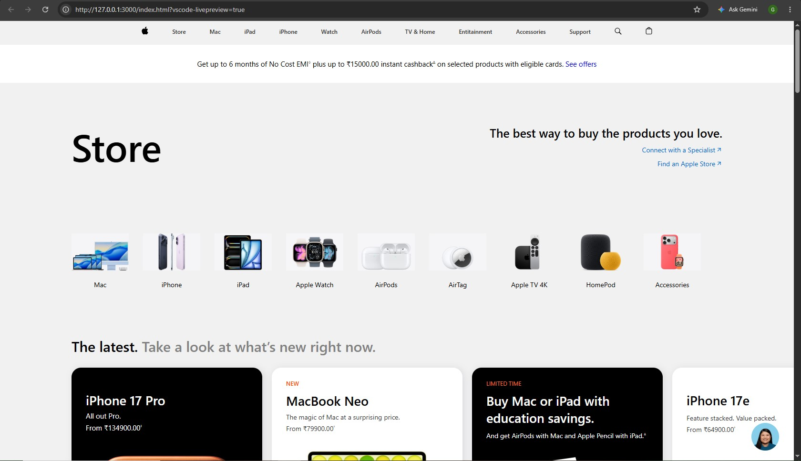

# Apple Homepage Clone

 A front-end recreation of Apple's homepage, built using pure HTML and CSS. 

 &nbsp;&nbsp;&nbsp;&nbsp;
  &nbsp;&nbsp;&nbsp;&nbsp; 

## ✨ About the Project

This project is a clone of Apple's official homepage, recreated using HTML and CSS.

The main goal was to practice front-end development by recreating Apple's clean and elegant design, focusing on page structure, styling, typography, and layout.

### 🚀 Built With
<ul><li>HTML5 – For structuring the webpage.</li>
<li>CSS3 – For styling, layouts, and visual presentation.</li></ul>

### 🎯 Features
<ul><li>Apple-inspired homepage design.</li>
<li>Clean and minimalistic layout.</li>
<li>Clean and minimalistic layout.</li>
<li>Product-focused sections.</li>
<li>Custom styling using CSS.</li>
<li>Built without any CSS frameworks or JavaScript.</li>
</ul>

### 📸 Preview

  

### 📚 What I Learned

While building this project, I got practical experience with:

Structuring webpages using HTML.
Working with CSS layouts and positioning.
Recreating an existing website design.
Improving my front-end development skills.

### 🛠️ Getting Started

To run this project locally:

Clone the repository:
<ol><li>git clone practice-project-apple-website-clone.
</li>
<li>Open the project folder.</li>
<li>
Open index.html in your browser.
</li></ol>

### 👨‍💻 Author

Goutam Kumar

<a href="https://github.com/im-goutam">&nbsp;&nbsp;&nbsp;&nbsp;</a>
<a href="https://github.com/im-goutam">&nbsp;&nbsp;&nbsp;&nbsp;</a>
